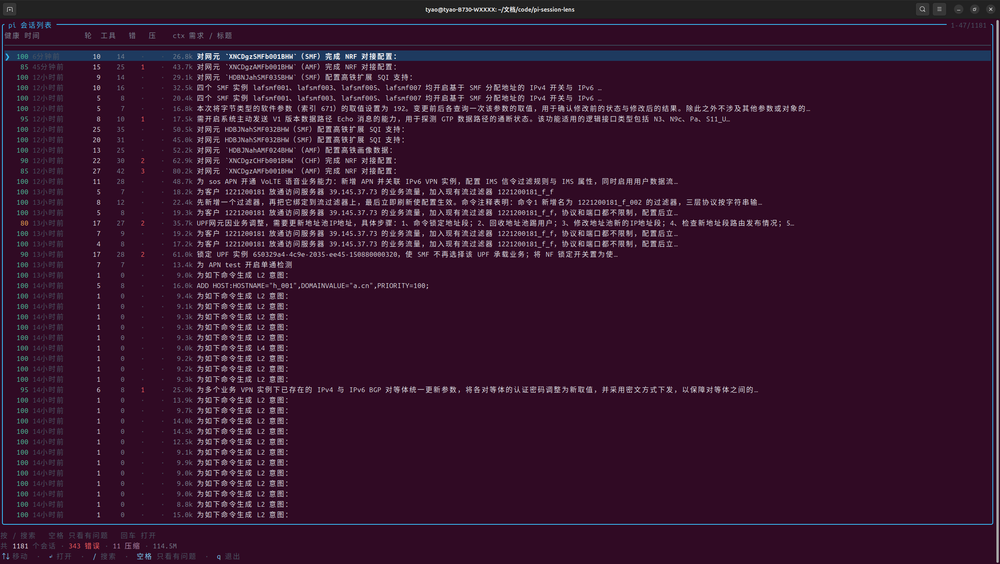
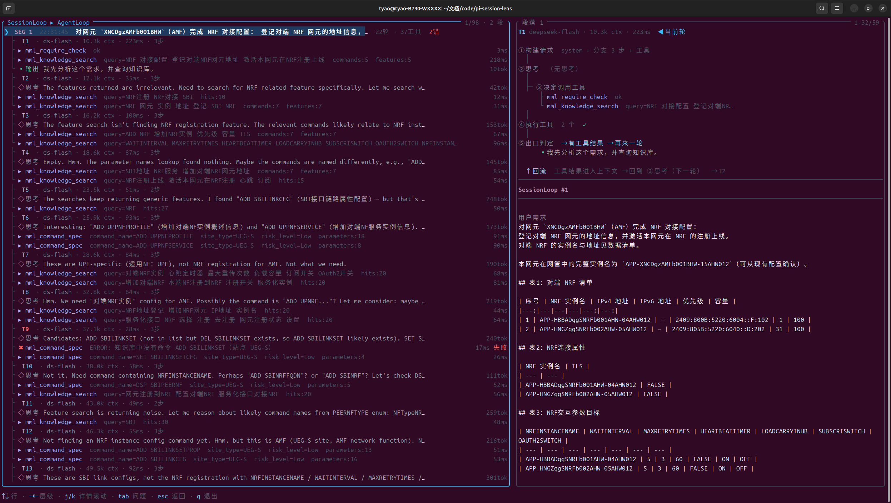
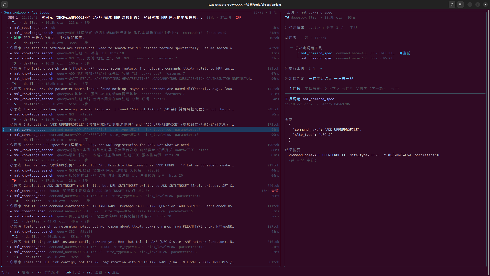

# pi-session-lens

pi-agent 会话可视化分析 —— **两层循环**终端界面，用来快速定位 agent 跑偏的原因。

读的是 pi 自己写的 jsonl 会话记录（`~/.pi/agent/sessions/**` 或工程内的
`var/pi_sessions`），不改动原始文件，纯只读分析。



## 时间轴 + AgentLoop 流程图

左侧是两层循环时间轴，右上方固定显示当前选中轮的**循环结构**，
在左侧移动光标时图上对应节点实时高亮（`◀ 当前`）：



选中某次具体的工具调用时，流程图会精确高亮到**那一次调用**，
同轮多次调用不会互相混淆：




## 为什么是「两层」

pi 的会话文件是一行一条记录的平铺 JSONL，但真实运行是嵌套的：

```
SessionLoop  一次用户请求
└─ AgentLoop  一个循环体（共享同一份意图与上下文）
   ├─ 迭代 1   ①构建请求 → ②思考 → ③调工具 → ④执行 → ⑤出口判定「继续」
   ├─ 迭代 2   ①构建请求 → ②思考 → ③调工具 → ④执行 → ⑤出口判定「继续」
   │   ⋮
   └─ 迭代 N   ①构建请求 → ②思考 → ③调工具 → ④执行 → ⑤出口判定「收敛」
```

| 层 | 含义 | 定位问题时看什么 |
|---|---|---|
| **SessionLoop** | 一段用户请求的生命周期 | 用户到底要什么；压缩前后是否丢了约束 |
| **AgentLoop** | 一个循环体，内部迭代 N 次 | 这个请求一共绕了多少圈、收敛了没有 |
| **迭代** | 一次模型往返（本工具早先误称为 turn） | 这一圈模型想干什么、调了什么、拿到什么 |
| **step** | 思考 / 工具调用 / 工具结果 / 输出 | 具体哪一步出错，参数错在哪 |

**迭代 ≠ 独立循环。** 这是最容易搞错的地方：pi 的一次用户请求内部，模型会
反复「思考 → 调工具 → 拿结果 → 再思考」，实测单个请求内有 **27 次模型往返**。
这些往返共享同一份用户意图和同一段上下文，属于同一个 AgentLoop 的不同迭代。
把每次往返当成并列的独立循环，会让流程图上每个节点都从「① 构建请求」重开，
视觉上看起来像跳过了构建请求 —— 实际是切分维度错了。

`compaction`（上下文压缩）是硬边界：压缩后模型只看到摘要，更早的原文
不再进入上下文。所以「模型忘了之前的要求」这类问题必须在 SessionLoop
层查，而不是在具体某一步里找。

## AgentLoop 流程图（与时间轴联动）

时间轴右上方固定显示**当前选中迭代**在循环里的位置，把整个 loop 的
迭代链一并画出来：前序迭代压成一行摘要，当前迭代展开五阶段，
后续迭代压成一行，loop 开头的汇总行给出「迭代次数 / 工具数 / 是否收敛」。

```
AgentLoop  27 次迭代 · 47 工具  ✔ 已收敛          ← 循环体汇总
迭代 1 / 共 27  9.3k ctx  45ms  ◀ 当前            ← 当前是第几圈
① 构建请求  system + 上下文 9.3k + 工具
② 思考  1 段 · 168tok
③ 决定调用工具  2 个
        ├ mml_knowledge_search  query=…  hits:10
        └ mml_knowledge_search  query=GRE隧道 创建  hits:10
④ 执行工具  2 个  ✓
⑤ 出口判定  → 有工具结果 → 继续循环
  ↺ 回流  工具结果进入上下文 → 回到 ① 构建请求继续循环  → 迭代 2
⋮ 后续 26 次迭代：mml_feature_steps+… → mml_knowledge_search → …
```

**联动规则**（选中什么，就亮什么）：

| 时间轴选中 | 图上高亮 |
|---|---|
| 段（SEG） | 该段第一个 loop，整体 |
| loop 行（↻ LOOP 1） | 该循环的第一次迭代 |
| 某次迭代 | `迭代 N / 共 M` 那行 |
| 思考 | `② 思考` |
| 某次工具调用 | 该次调用那一行（同轮多次调用也能精确区分） |
| 工具结果 | `④ 执行工具` |
| 输出文本 | `⑤ 出口判定` |
| 压缩 | `▣ 上下文压缩` 节点 |

出口判定会区分：有工具结果 → **回流**继续循环；给出文本 → **收敛**结束；
`stopReason=length` → 截断；`aborted` → 中断；压缩 → 循环被切断。


## 上下文压缩：查「到底压掉了什么」

pi 的 compaction entry 只存**摘要结果**，不存摘要请求的 prompt ——
所以「完整的压缩输入」在磁盘上并不存在，任何工具都无法还原。但**被压缩的
原文仍在同一个 jsonl 里**，用 `firstKeptEntryId` 可以精确切出范围。

在时间轴或问题面板按 `c` 进入压缩对比视图：

```
╭ 被压缩的原文 ───────────── 76 条 · 104.6k 字符 ╮ ╭ 摘要（压缩输出） ──────────╮
│❯ user          5.1k  先创建 L3VPN 实例 vpn.CMNB…│ │压缩比 115.8k → 5.4k  省 95%│
│  assistant      353  [思考] Let me start by sear…│ │76 条原文 / 104.6k 字符 → … │
│  toolResult    4.5k  mml_knowledge_search: 创建…│ │摘要调用: 输入 47.2k tok    │
│  toolResult    5.4k  mml_knowledge_search: GRE…│ │⚠ pi 不保存摘要 prompt      │
╰──────────────────────────────────────────────────╯ ╰────────────────────────────╯
```

右栏 `Tab` 切换三种视角：

| 视角 | 内容 |
|---|---|
| **摘要** | 压缩输出全文 + 压缩比 + 摘要调用的 token 消耗 |
| **条目全文** | 左栏选中那条原文的完整内容（逐条核对） |
| **漏词核对** | 原文里出现、摘要里找不到的**具体取值** |

漏词核对是这个视图最有用的部分。压缩摘要是自然语言改写，全量 diff 全是噪音，
所以只提取真正要命的东西：**命令名**（`ADD XXX`）、**IP/掩码**、
**参数名**（`KEY=`）、**对象名**（`vpn.*` / `tunnel10294`）。
丢命令名会生成错命令，丢 IP/对象名会配错对象 —— 每条都标出现次数。

在真实会话上实测：76 条原文 / 104.6k 字符 → 7855 字符摘要（5426 token），
检出 17 个缺失取值（含 `MOD GRETUNNEL`、`DSTIPADDR`、`173.16.0.0` 等）。

**多次压缩**时，每次的起点是「上次的保留边界」而不是上次 compaction 自身
（否则已保留下来的消息会被重复算成被吞掉）。这条边界规则有专门的测试固定住。

`n` / `N` 在多次压缩之间切换。

## 快速开始

零依赖，不需要 `npm install`（要求 Node >= 22.6，用原生类型擦除跑 `.ts`）：

```bash
node bin/pi-lens.ts                                  # 自动探测会话目录
node bin/pi-lens.ts ./var/pi_sessions                # 指定目录
node bin/pi-lens.ts ./var/pi_sessions/xxx.jsonl      # 直接打开某个会话
```

放到 PATH 里当命令用：

```bash
npm link              # 之后可用 `pi-lens`
# 或
alias pi-lens="node $PWD/bin/pi-lens.ts"
```

### 会话目录探测顺序

1. `PI_LENS_SESSION_DIR`（多个用 `:` 分隔）
2. `~/.pi/agent/sessions`（pi 默认位置）
3. `./var/pi_sessions`（工程内自带会话目录的约定）

## 键盘

| 键 | 作用 |
|---|---|
| `↑` `↓` | 移动（列表 / 时间轴 / 问题） |
| `→` `←` | 时间轴：进入更细层级 / 回到上一层 |
| `Enter` | 打开会话 / 从问题跳到现场 |
| `Tab` | 时间轴 ⇄ 问题面板（压缩视图内切右栏视角） |
| `c` | 上下文压缩：摘要 ⟷ 被压缩原文 ⟷ 漏词核对 |
| `/` | 搜索会话（`Esc` 取消） |
| `空格` | 列表页：只看有问题的会话 |
| `r` | 重新扫描目录（列表）/ 重新加载会话（会话内） |
| `a` | 列表页：开关自动刷新 |
| `Z` / `E` | 时间轴：全部折叠到段 / 全部展开 |
| `z` | 时间轴：按粒度折叠（迭代 → 循环 → 段，循环切换） |
| `←` | 时间轴：折叠当前节点；已折叠则回到上一层 |
| `j` `k` | 滚动右侧详情 |
| `g` `G` | 跳到首 / 尾 |
| `n` `N` | 跳到下一个 / 上一个问题（压缩视图内切第 N 次压缩） |
| `?` | 帮助（含两层循环的解释） |
| `q` `Esc` | 退出 / 返回上一层 |

### 折叠

层级深时（一个请求就有 27 次迭代）时间轴会很长，折叠用来快速定位：

```
▸  SEG 1  先创建 L3VPN 实例…  27轮 · 47工具  ⋯100     ← 折叠后显示藏了多少行
▸  SEG 2  将vpn.CMBIOTONENET.ZJ改为…  16轮 · 28工具  ⋯61
▸  SEG 3  ▣压缩后  将vpn.CMBIOTONENET.ZJ改为…  6轮  ⋯24
```

- `Z` 一键折叠到只剩 SEG 行（7 段会话从 237 行降到 7 行）
- `E` 一键全展开
- `z` 按粒度循环切换：先折迭代、再折循环、再折段 —— 每次折叠后正好是一层总览
- `←` 对可折叠节点是「折叠」，已折叠时才是「回上一层」，符合树形浏览习惯
- 折叠状态下按 `→` 优先展开当前节点
- **跳转自动展开**：从问题面板回车跳转时，会自动展开目标所在的所有祖先，
  否则行是隐藏的，光标会落空（表现为「按了回车但什么都没发生」）

### 自动刷新

列表页默认**每 10 秒自动重新扫描**会话目录，新建的会话会自动出现在顶部。
底栏右侧显示刷新状态与模式，例如 `刚刚刷新  自动`。

- 只在列表页刷新：在时间轴里看会话时不会被打断；从会话返回列表会立即补刷一次
- 搜索中、加载中会自动跳过，不打断操作
- `a` 关掉自动刷新后变手动模式，`r` 随时手动刷
- 刷新会重新扫描目录（不是复用启动时的文件快照），所以新会话能被发现；
  已有文件走 mtime+size 缓存，1000+ 会话的增量刷新通常只需几十毫秒

## 问题信号

问题面板会自动检出这些信号，每条都能回车跳到现场：

| 信号 | 级别 | 判定 | 含义 |
|---|---|---|---|
| **查无结果** | info | `知识库中没有命令 XXX` / `不支持的命令` | 检索得到的**有效结论**，不是故障 |
| **步骤核对** | info | `feature_steps` 返回 `missing[]` | 有步骤未覆盖，是核对结论 |
| 执行失败 | error | 网络 / 超时 / 未执行 / 崩溃 | 工具真的挂了，需要看 |
| 缺必填参数 | warn | `missing_required` **非空** | 需补齐参数 |
| 参数非法 | warn | `RENDER_FAILED` / `param_errors` 非空 | 枚举、位域后缀、格式错 |
| 压缩 | warn | `compaction` entry | 上下文断点，排查「忘要求」 |
| 截断 | warn | `stopReason=length` | 输出被上限截断 |
| 发散 | info | 同参数重复调用 | 模型原地打转 |
| 大返回 | info | 单次结果 > 20k 字符 | 推高上下文占用 |

### 为什么「查无结果」不算错误

pi 的工具在知识库查不到命令时会返回 `isError=true` + `error: "知识库中没有命令 X"`。
但这是**检索成功得到的结论**：模型查了、确认没有、没有凭记忆瞎编命令——
这一步做得对。真实数据里这类返回占 isError 的 66%（337 条里 222 条），
全部报成错误会让问题面板充满噪音，把参数错、工具挂了这些真正要看的东西淹掉。

所以工具返回被分成 6 类语义（`ok` / `not_found` / `step_gap` /
`missing_params` / `invalid_params` / `real_error`），只有后三类计入问题。

判定时有个坑必须避开：**成功的返回里也会带 `"missing_required": []`**，
只按字段名匹配会把成功误判成「缺参数」（实测误报 4 条）。必须判断数组非空。

健康分 0-100：从 100 起按 error/warn 数和压缩次数扣分，并惩罚
「turn 很多但几乎没有文本输出」（说明一直在打转没收敛）。info 级不扣分。
在 1181 个真实会话上，修正分类后平均健康分 97.7，仅 63 个低于 85 分。


## 非交互用法

```bash
node bin/pi-lens.ts --list ./var/pi_sessions        # 会话表格（适合 grep）
node bin/pi-lens.ts --analyze xxx.jsonl             # 单会话完整文本报告
node bin/pi-lens.ts --plain --width 120 xxx.jsonl   # 渲染一帧快照（CI 用）
```

`--analyze` 的输出包含：会话概览、工具使用分布、问题清单（带参数原文）、
两层循环大纲。

## 把解析能力当库用

`src/core` 与 UI 完全独立，可以在自己的脚本里直接 import：

```ts
import { parseSessionFile } from "./src/core/parser.ts";
import { analyzeSessionFile } from "./src/core/analyze.ts";

// 原始层：entries / 当前分支 / 累计 usage / 坏行数
const s = await parseSessionFile("/path/to/session.jsonl");
console.log(s.branch.length, s.typeCounts, s.totalUsage);

// 分析层：两层模型 + 问题列表 + 健康分
const a = await analyzeSessionFile("/path/to/session.jsonl");
for (const seg of a.segments) {
  console.log(`段 ${seg.index}: ${seg.prompt.slice(0, 40)}`);
  for (const turn of seg.turns) {
    console.log(`  T${turn.index} ${turn.steps.length} 步, ctx=${turn.contextTokens}`);
  }
}
for (const iss of a.issues) {
  console.log(`[${iss.severity}] ${iss.title} @ ${iss.stepKey}`);
}
```

## 设计要点

**容错优先**。pi 会持续演进 entry 类型；解析器遇到未知类型只计数、不抛错，
并在 UI 里提示（而不是白屏）。坏行、扩展 role、残缺 JSON 同样跳过。

**中文宽度**。会话以中文为主，全角字符占 2 列。所有布局都走
`visibleWidth` / `truncateToWidth`（优先复用 pi 自带的 pi-tui 实现，
找不到时用内置兜底），并有 5 种终端尺寸 × 每行宽度的自动化断言 ——
宽度错一列就会让整个 TUI 逐行错位，这是最难靠肉眼发现的一类 bug。

**差分渲染**。只重绘变化的行，SSH 下不拖影。终端不支持颜色时
（`NO_COLOR` / 管道）自动降级为纯文本。

**归并而非平铺**。一次 assistant 响应可能带多个 toolCall，
按 turn 归并才能看出「模型一次决策了几个动作」；toolResult 会回填到
对应的 tool_call 上，而不是拆成两条互不相干的消息。

## 验证

```bash
bash scripts/verify.sh          # 单元 + 布局 + 主题 + CLI 冒烟（约 3 秒）
bash scripts/verify.sh --full   # 额外跑 7 个 pty 交互场景（约 40 秒）
```

交互验收用真实 pty 驱动：Node 的管道 stdin 会被内核行缓冲，
按键驱动的 TUI 在管道里根本收不到单字符 —— 必须分配 pty 才能真实验证。

## 目录

```
bin/pi-lens.ts              CLI 入口（参数解析、模式选择）
src/core/                   与 UI 无关的分析能力
  types.ts                  pi session 格式的类型定义（对应官方 doc）
  parser.ts                 jsonl 解析、建树、内容提取、token 估算
  model.ts                  两层循环的数据模型（Segment/Turn/Step/Issue）
  turns.ts                  entry → AgentLoop turn 归并
  segments.ts               turn → SessionLoop 分段（含压缩边界）
  prompts.ts                用户提问提取（剥离系统说明）
  issues.ts                 问题信号检测 + 健康分
  compaction.ts             还原每次压缩吞掉了哪些 entry（firstKeptEntryId 边界规则）
  analyze.ts                分析入口（组合以上各层）
  discover.ts               会话文件发现
  summaries.ts              会话摘要 + 磁盘索引缓存
  report.ts                 文本报告 / 表格输出
src/ui/
  app.ts                    输入循环、状态流转、视图调度
  state.ts                  运行时状态与时间轴行展开
  view-list.ts              会话列表
  view-timeline.ts          两层循环时间轴 + 流程图 + 详情
  flow-diagram.ts           AgentLoop 循环流程图（含节点高亮映射）
  view-issues.ts            问题面板
  view-compaction.ts        压缩对比（摘要 / 原文 / 漏词核对）
  view-help.ts              帮助（解释两层循环概念）
  render.ts                 面板边框、滚动视口
  text.ts                   宽度 / 截断 / 换行 / 格式化
  theme.ts                  语义色与图标（单一来源）
  ansi.ts                   ANSI 着色（零依赖）
  keys.ts                   原始键盘解析
  screen.ts                 备用屏幕 + 差分渲染
  pi-tui-loader.ts          复用 pi 自带 pi-tui 的定位逻辑
tests/                      单元 / 布局 / 主题 / 流程图联动 / 压缩还原测试
scripts/                    verify.sh（按需验证）、interact.mjs+pty_driver.py（pty 交互验收）
docs/screenshots/           README 用运行截图
```

## 与 config-generation-design-agent 的关系

本项目是配套的可视化分析工具：它读那边的 `var/pi_sessions/*.jsonl`，
但不 import 那边的任何代码，也不回写任何文件。解析逻辑完全按
pi 官方的 session 格式规范实现，因此也能看任意 pi 项目的会话。
